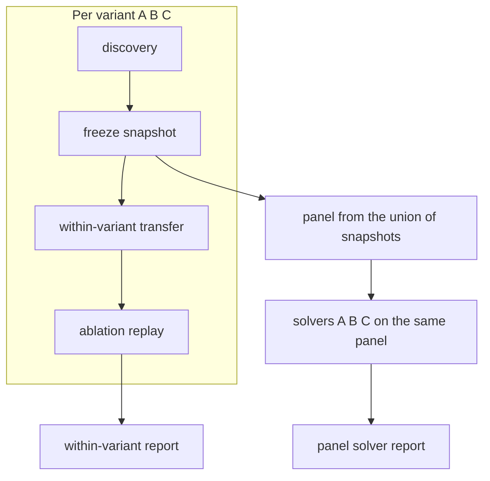

# Plan v3: an autonomous laboratory and knowledge transfer

> **Not implemented.** This document is a future experiment. There is no `src/v3/`, no `python -m v3`, no config file, and no run. Nothing here is a result. v1 and v2 do not import this plan.

A separate experimental run. **Question:** can frozen language models, cut off from a ready-made task list, in one narrow area of mathematics **develop checkable knowledge on their own** (a graph of concepts, methods, theorems, and refutations), and then **use that knowledge** to solve **new** problems generated by the system, in a way shown **counterfactually**, rather than by counting cards in a loop.

The core stays short: the more "wisdom" written into code outside the protocol, the harder it is to tell the model's ability from the experimenter's rules.

## What this run does not assume

- Weight training, fine-tuning, RL.
- A ready list of problems for the agents (nor the millennium problems).
- Consensus, voting, or an "interestingness" score from an LLM.
- Import of findings, code, or prompts from v1/v2 (`src/kanon/` and the earlier plans are outside this run).
- A proof of "new world mathematics", or that the model's weights improved.

## What a positive result shows, and what it does not

| Claim | Positive evidence | What it does **not** show |
|---|---|---|
| The laboratory **does research** without an external task list | Discovery produces graph nodes with tool artifacts (tests, counterexamples, possibly Lean) and explicit edges `uses` / `refines` / ... | That the discoveries are **interesting to human mathematicians** outside the chosen micro-area |
| **Memory** is used, not only stored | An ablation counterfactual (Full pass, Ablation without the named node fails) **and** a mechanical `declared_uses` manifest that matches `ablation_plan`; a citation with no effect on the oracle does not count | That the model "understands". Only that the **protocol** forces the counterfactual and the consistency of the manifest with the ablation plan |
| **Knowledge transfer** to new challenges | Frozen transfer challenges: full memory versus ablations (removed ancestor or method) at a **paired budget**; a criterion that resists chance (repeats, leak control) | That every card with high `formal_valid` describes the same thing as its natural-language label (`semantic_alignment` has to pass separately) |
| **Diversity** of the research process | Separate discovery plus freeze per variant A/B/C; B requires operational sampling (`temperature_diversity`, seed); C uses different `model_id` on the lines | That a raw `transfer_pass` between variants with **different** challenge sets is a model ranking. That job belongs to the **shared panel** |

## Starting area (an empty seed)

- **One** bounded fragment of mathematics: **integer arithmetic**. Division with remainder, primality, simple congruences mod \(n\) for small \(n\) fixed in the DSL canon (for example \(n \in \{2,3,5,7\}\)).
- An **empty graph** at the start: no nodes beyond a possible root `domain:int_arithmetic` (a definition of the area, not a theorem).
- Prompts contain **no** example hypotheses and no list of "interesting" facts. The only fixed content is the allowed DSL constructs and the protocol rules.
- Agents choose the research direction only from the graph **frontier** (gaps, open `conjecture`, missing `uses` / `enables`).

## Roles, the clerk, and architecture variants

The **clerk** (Python) enforces the protocol, the budget, the draw, the container, the raw artifacts, and **statuses from tools**. It does not grade mathematics or "interestingness".

LLM roles have fixed prompts in `src/v3/roles/` once that tree exists. A **dispute** does not go through a vote. The **container** settles it (a counterexample, or none in the space) or **Lean** does, on the canonical statement.

### Temperature and sampling (without a contradiction)

| Role class | `temperature` | Note |
|---|---|---|
| **Verifier / formalizer** | `temperature_verifier` = `0` (manifest) | Transfer and panel solver, Lean formalizer; researcher and critic in **A** and **C**. In **B** researchers and critics use the Diversity row below, not temperature 0 pretending to be two lines |
| **Diversity** (mandatory for **B**) | `temperature_diversity` > 0 plus **different** `seed` per line, stored in `trace.jsonl` | The discoverer (2 proposals) and **both** researcher/critic pairs in B. In **C** architectural diversity is different `model_id`; researcher and critic stay on `temperature_verifier` (0). Do **not** raise temperature to simulate B |
| **Provider `seed`** | Required for variant **B** | If the adapter cannot set an **independent** seed per call (declared in `providers.capabilities`), variant B is **`variant_status: skipped`** (`B_invalid_no_independent_sampling`). It is **not** replaced by A |

A `session_id` on a stateless API does **not** count as independence.

### Variant **A**, minimal architecture (baseline)

Exactly **one** model (`model_id`) in three roles, **without** a dual oracle:

| Role | Count | Output |
|---|---|---|
| Discoverer | 1 per step | ClaimAST plus `proposed_edges` |
| Researcher | 1 per node to verify | TestSpecAST (`mode: support`) |
| Critic | 1 per node | TestSpecAST (`mode: counterexample`) or an empty attack |

Order: discoverer, then researcher, then critic (separate calls). There is no curtain between parallel oracles, because there is **no** second researcher/critic pair.

Empirical rule: if the critic returns a valid TestSpec and the container yields `counterexample`, the status is `refutes`. If the researcher supports inside a bounded space and the critic does not refute, `empirical_status: supported_in_bound`. A disagreement **inside** one pair (for example a container error) is `open` plus an `oracle_error` entry, not an `oracle_dispute` between models.

### Variant **B**, sampling diversity (the same `model_id`)

**Validity condition:** `providers.*.supports_seed == true` **and** `temperature_diversity > 0` in the manifest. Otherwise `variant_status: skipped`, and the report notes `B_invalid_no_independent_sampling`.

At least **2 independent research proposals** and **2 independent critiques** of the same `claim` (the same canonical template from ClaimAST):

| Role | Count | Operational independence |
|---|---|---|
| Discoverer | 2 proposals per frontier step (or 1 discoverer times 2 calls) | Different `seed` plus `temperature_diversity` |
| Researcher | 2 (`researcher_1`, `researcher_2`) | The same base prompt, different `(seed, temperature_diversity)` |
| Critic | 2 (`critic_1`, `critic_2`) | As the researchers; **no** view of the other line's TestSpec before the freeze |

**Curtain (B; likewise C on a shared node):** answers of lines 1 and 2 are **masked** until every TestSpec of that step is frozen. Only then does the clerk generate and run containers.

**Dispute between lines:** both oracles of the same type go to the container. A counterexample from **any** line yields `refutes`. `oracle_dispute` when container results differ on valid TestSpecs.

**Budget:** token sum (discovery plus transfer) **equals A**. The clerk splits the budget across more calls (fewer discovery steps, or a lower `max_tokens` per role). The `budget` section of `configs/experiment.yaml` defines the **total** limit, not a per-call limit.

### Variant **C**, different models (heterogeneity)

At least **2 different** `model_id` values. Each model has its **own** research line and critique line (1 researcher plus 1 critic per line):

| Line | Discoverer | Researcher | Critic |
|---|---|---|---|
| `line_1` | `model_id` L1 | L1 | L1 |
| `line_2` | `model_id` L2 | L2 | L2 |

A discovery step runs **in alternation** or **in parallel with a 50/50 budget split** between lines (the manifest chooses `discovery_schedule: alternate|parallel`). Each line develops the same graph (a shared SQLite database), but proposals come from different models. The curtain between lines is as in B when both lines verify a shared node.

**Total budget equals A equals B.**

## Experimental configurations A / B / C

**Three separate full runs** under an **identical** total budget (`discovery_max_tokens`, `transfer_max_tokens`, `discovery_max_steps`, container limits):

```
runs/{experiment_id}/A/   -> discovery, freeze, transfer (within-variant)
runs/{experiment_id}/B/   -> the same, or `skipped` if sampling is not valid
runs/{experiment_id}/C/   -> the same
runs/{experiment_id}/panel/  -> shared challenge panel (after freeze of A/B/C)
```

| Label | Architecture | What it tests |
|---|---|---|
| **A** | 1 discoverer, 1 researcher, 1 critic, one model | Baseline: whether a single pipeline builds a graph at all and passes the Full/Ablation/Empty counterfactual |
| **B** | 2 research proposals plus 2 critiques, the same model, seed plus `temperature_diversity` | Whether **controlled** sampling changes the quality of **discovery** and of transfer **inside the same variant** |
| **C** | at least 2 lines with different `model_id` | Whether model heterogeneity changes **how knowledge appears** (a separate graph per run) |

**Do not compare directly** the within-variant `transfer_pass` rate across A, B, and C. Each variant has its **own** `transfer_challenges.json`, generated from **its** snapshot. The sets can differ in difficulty. That is **not** a clean model ranking.

**Provider:** interface `complete(config, system, user) -> Completion` with fields `base_url`, `api_key`, `model_id`, `temperature`, `max_tokens`, and optionally `seed`. File `providers.capabilities.json` (per endpoint): `supports_seed: bool`. An OpenAI-compatible API and local endpoints (llama.cpp, vLLM) go through the same adapter. A missing required field ends the variant run before discovery.

Planned implementation, not present: `src/v3/providers/base.py`, `src/v3/providers/openai_compat.py`. Tests would use `FakeProvider` (deterministic seed).

## Memory: the knowledge graph

Durable store: **SQLite** plus an export `graph.json` (snapshot). Nodes and edges have fixed types.

### Node types

`concept` | `definition` | `conjecture` | `lemma` | `method` | `counterexample` | `problem`

**Type `problem`:** during discovery, agents do **not** create `problem` nodes. Only the transfer generator materializes that type at freeze. This removes challenges "written in" by the discoverer and guarantees that \(T\) was not in the frontier window.

### Edge types

`uses` | `refines` | `refutes` | `generalizes` | `enables`

**Use rule (mechanical, no LLM judgment):** in the transfer phase the artifact `artifacts/{T}.solution.json` (schema `solution_v1`) contains `declared_uses: [uuid, ...]`. A `uses` edge from the solution to \(Y\) is **accepted** only when:

1. \(Y\) is in `ablation_plan.json` under `required_ancestors[T]` (nodes chosen deterministically from the graph; see transfer),
2. \(Y\) is in `declared_uses`,
3. the pair (Full, Ablation without \(Y\)) meets the transfer criterion on the **frozen** oracle (below).

**Anti-citation:** if Full passes while Ablation without \(Y\) also passes, and the agent still lists \(Y\) in `declared_uses`, the flag is `cite_without_effect` (it does not strengthen `transfer_pass`). The clerk does **not** judge whether the statement was "logically necessary" beyond that counterfactual.

### Scoring axes (no single "proved", and no weight improvement)

| Dimension | Where in the protocol | Note |
|---|---|---|
| **Activity** | `metrics_activity.csv`, graph depth | Does not imply correctness or transfer |
| **Empirical / formal correctness** | `empirical_status`, `formal_valid` | Bounded search is not a proof; Lean is optional |
| **Semantic alignment** | `semantic_alignment` | AST mapped to tools, not a natural-language label |
| **Transfer** | `research_value` | Only the Full/Ablation/Empty counterfactual |
| **Improvement of model weights** | none | **Out of scope.** This run does not measure it |

Every node that has a `claim` (conjecture, lemma, problem) carries **three status fields on the graph** (transfer is a separate axis on `problem` nodes from the transfer phase):

| Axis | Field | Who sets it | Meaning |
|---|---|---|---|
| **Formal correctness of a proof** | `formal_valid` | `unknown`, `valid`, `invalid`, or `na` | Lean 4 exits 0 on a file whose **only** theorem to prove is `theorem lab_{id} : {lean_statement}`, where `{lean_statement}` comes **only** from ClaimAST (not from the agent's text). After compilation the clerk runs `#print axioms` for that theorem: only Mathlib axioms on the whitelist in `lean/allowed_axioms.txt` are allowed. `invalid` on `sorry` / `admit`, a new `axiom`, `unsafe`, a missing type declaration, or a type mismatch against the generated statement. A description in the prompt is **not** Lean-validated. |
| **Semantic alignment** | `semantic_alignment` | `unknown`, `aligned`, `misaligned`, or `unformalizable` | Hashes and a parser only. `H_ast = hash(canonicalize(claim_ast))`. The clerk generates the test IR and the Lean fragment. `aligned` iff both generators succeed **and** `hash(test_oracle_ir) == H_test(H_ast)` and `hash(lean_fragment) == H_lean(H_ast)` (mapper version in `manifest.json`). **Template text and the natural-language label are not part of the comparison.** `unformalizable` when the AST uses a constructor outside `grammar.lark` or a sort outside the mapping dictionary. |
| **Research value / transfer** | `research_value` | `unknown`, `transfer_pass`, `transfer_fail`, or `not_evaluated` | Set **only** in transfer evaluation after the counterfactual (below). Discovery does not set `transfer_pass`. |

**Presentation rule:** UI and reports **never** fold these axes into the one word "proved". A report may at most print the triple literally.

### Canonical artifact (the semantic source of truth)

One JSON file per node: `artifacts/{node_id}.claim.json`, a **ClaimAST** (versioned schema `claim_v1`). From it the clerk **deterministically** generates:

1. text for the agent window (a template, not a paraphrase by the model),
2. the test oracle (`tests_gen/{node_id}.json`),
3. `lean_statement` (a fragment `lean/{node_id}.lean`).

The model is **not** the source of truth for (2) or (3). If the model returns a ClaimAST that does not parse or is inconsistent with the DSL, the `conjecture` node stays `open`, with a `malformed` entry in the trace.

## DSL / ClaimAST (minimal)

Goal: bound the language so the mapping to tests and to Lean is mechanical.

Grammar, when implemented: `src/v3/dsl/grammar.lark` plus `src/v3/dsl/claim_ast.py`. **Semantics:** every AST node has a `node_kind` tag from a closed list. Meaning is an interpretation in `Int` (standard arithmetic) or `Bool`:

| `node_kind` | Semantics (short) |
|---|---|
| `const_int` | A literal of \( \mathbb{Z} \), validated by \(\|v\| \leq 10^6\) |
| `var` | A variable bound by `ForAll` / `Exists` |
| `not`, `and`, `or`, `implies` | Standard connectives on `Bool` |
| `eq`, `lt` | Equality / order on `Int` |
| `prime`, `divides` | Primality; \(a \mid b\) |
| `forall`, `exists` | Quantification over a finite set (`int_range`, `mod_list`) |
| `mod_eq` | Congruence \(a \equiv b \pmod n\), \(n\) from the modulus canon |

- Sorts: `Int`, `Bool`. **No** implicit cast.
- Constants in tests: the same bound as in AST validation.

**Canonicalize:** sort JSON keys, normalize modulus lists, then a `hash` that is stable across runs.

The discoverer returns **only** JSON:

```json
{
  "node_type": "conjecture",
  "claim_ast": { "...": "a tree matching schema claim_v1" },
  "parent_ids": ["..."],
  "proposed_edges": [
    {"from": "self", "to": "uuid", "kind": "refines"}
  ]
}
```

Researcher and critic return a **TestSpecAST** (not arbitrary Python), **only in discovery** (an empirical attack or support on a graph node):

```json
{
  "kind": "finite_search",
  "claim_ref": "node_id",
  "search_space": {"type": "int_range", "lo": 2, "hi": 5000},
  "mode": "counterexample"
}
```

or

```json
{
  "kind": "witness",
  "claim_ref": "node_id",
  "witness_expr": {"ast": "..."}
}
```

`mode` is `counterexample` or `support`. It does **not** change ClaimAST. The generator maps `mode` plus `claim_ref` onto code that checks the **same** `test_oracle_ir` as the node's ClaimAST. The agent chooses only the **space** or the **witness**, not the definition of truth.

**Transfer phase:** the agent does **not** define the oracle. Truth is `tests_gen/{challenge_id}.json`, frozen at `freeze`. The agent returns at most a `SolutionAttemptAST`: `declared_uses`, and optionally `witness_expr` or `search_space` **bounded** by `challenge.search_bounds` from the manifest. The verdict `solved` is allowed only when the frozen oracle returns pass (for example a witness that satisfies the challenge ClaimAST).

The clerk **rejects** a `verdict` field from the model. The verdict comes only from running the generated test code.

## The clerk: running tests (without trusting model stdout)

1. From each accepted TestSpecAST the generator (`src/v3/oracle/generate.py`, planned) produces a **short** Python script (SymPy or numpy only if they are on the whitelist).
2. The script runs **only** in a container (`src/v3/oracle/container.py`, one policy, to be tested in CI):
   - `docker run --network none --read-only --cap-drop=ALL --security-opt no-new-privileges --pids-limit 64 --memory 512m --cpus 1`,
   - image pinned by digest in `manifest.json` (for example `python:3.11-slim@sha256:...`),
   - mount only `/tmp` (rw, `tmpfs`, size 64 MiB) for the result; the script and inputs are a **read-only** bind from the run directory,
   - no Docker socket mount, no `--privileged`, a non-root user in the image (`USER 65534`),
   - timeout: 5 s for an empirical test, 90 s for Lean,
   - the container is **removed** afterwards (`--rm`).
3. The **script AST** (`ast` parse) whitelists imports (`math`, `sympy` if it is in the image) and forbids `open`, `subprocess`, `socket`, `eval`, `exec`. This is an **extra layer**, not a replacement for isolation. The plan does **not** claim absolute security: it is a reduction of the attack surface on the host, not a proof of full isolation.
4. The container result is JSON on stdout (`{"outcome": "counterexample", "witness": "..."}`, or `{"outcome": "no_counterexample_in_space", "n_checked": 5000}`, or `{"outcome": "error", "code": "..."}`).

**Empirical status in discovery (depends on the variant):**

- **A:** one critic plus one researcher. A counterexample from the critic's container yields `refutes`. Researcher support with no counterexample yields `supported_in_bound`.
- **B/C:** a counterexample from **any** critic line yields `refutes`. Empirical support requires no counterexample on **every** critic line that returned a valid TestSpec. Different container outcomes on valid specs yield `oracle_dispute`, and the node stays `open`.

## Lean (optional in the implementation, status spec from day 1)

After a working DSL and transfer without Lean: the clerk inserts the **generated** `lean_statement` into a template:

```lean
import Mathlib

theorem lab_{id} : {lean_statement} := by
  {tactics}
```

Tactics come from a separate researcher call **only** when `empirical_status` supports the node and `semantic_alignment != unformalizable`. After compilation: scan the file for `sorry` / `admit` / a new `axiom`, and compare `#print axioms` with the whitelist. Lean sets **only** `formal_valid` on the source ClaimAST node. It does **not** set it on a transfer challenge, unless a separate discovery formalization step does. If Lean is absent, `formal_valid` is `na` and the run continues.

## Autonomy of a discovery step

The clerk does **not** pick an "interesting" topic. The only program heuristic:

1. Build the **frontier**: `open` / `conjecture` nodes without a decision, `lemma` / `method` nodes missing expected `uses` / `enables` edges, gaps in `refines`.
2. Draw uniformly among the top-\(k\) by **depth** (prefer extending existing lines), using the run seed.
3. Call the discoverer according to the variant (A: 1 call; B: 2 proposals with different `(seed, temperature_diversity)`; C: the discoverer of the active line) with a window of the chosen nodes plus the edge neighborhood (type, id, three-axis status, a ClaimAST digest from the template).

Limit: max `revision_depth` 3 on a `refines` line. Then the clerk forces `abandoned` with reason `revision_cap`.

Agent window, a whitelist of node fields: `id`, `node_type`, `claim_template`, `formal_valid`, `semantic_alignment`, `research_value`, `empirical_status`, `parent_ids`, and 1-hop edges. **No** `trace`, no other role's TestSpec, no raw answers of other roles.

## Phases of a run

Each variant A/B/C walks its **own** phase chain. After the three freezes, a **shared solver panel** is built.



### 1. Discovery (separate per variant)

A step loop until the **same** `discovery_budget` as the other variants is spent. Writes: `runs/{experiment_id}/{A|B|C}/memory.sqlite`, `trace.jsonl`, `artifacts/`, `metrics_activity.csv`.

Role architecture matches the variant (A: a single pipeline; B: dual proposals plus seed; C: model lines).

**Activity metrics** (not success): node count per type, graph depth, count of `refutes`, `oracle_dispute` (B/C), tokens, container time.

### 2. Freeze snapshot (separate per variant)

```bash
PYTHONPATH=src python -m v3 freeze \
  --run runs/{experiment_id}/A \
  --out runs/{experiment_id}/A/snapshot_{ts}/
```

(the same for `B` and `C`)

Contents: `graph.json`, a hash of `artifacts/*.claim.json`, `manifest.json` (variant, budget, seed, `temperature_diversity`, model assignments). After freeze **no** agent mutates that snapshot.

These commands are the planned interface. They are not installed.

### 3. Within-variant transfer evaluation (the main autonomy criterion)

This concerns **only** the snapshot of the **same** variant (`runs/.../A/snapshot/...` solves challenges from graph A). The dual oracle (B) and the model lines (C) belong to **discovery**. The **transfer solver** is **one** call per (challenge, repeat, memory condition), at the same total token cost in every variant (in B the same `model_id` as in A; in C `solver_line` from the manifest, default `line_1`).

**Before** any agent solves anything:

1. The transfer generator (`src/v3/transfer/generate.py`, planned) reads **only** the frozen `graph.json` plus a rule file **`transfer_rules.yaml`** (AST transformations, not a list of ready tasks). Rules are **parametric** schemas, for example "compose lemmas L1 and L2 through `mod_eq` on a modulus from the canon", "hide one quantifier in method M". **No rule may contain a concrete ClaimAST or text written by a human for that run.** Only transformation names and slots (`{lemma_id}`, `{mod}`) filled by nodes from the graph.
2. Candidates \(T\) must satisfy:
   - `ClaimAST` generated deterministically (`seed_transfer`, node order in the graph),
   - **`T` does not appear** in any discovery prompt (no `node_id` in `trace.jsonl` as `claim_ref` or in the frontier window),
   - at least one node in `required_ancestors[T]` comes from discovery (otherwise transfer has no point).
3. For each \(T\) the clerk **immediately** materializes `artifacts/{T}.claim.json` and `tests_gen/{T}.json` (hash in `manifest.json`). **A mutation of those files after the hash invalidates the run.**
4. The list is stored as `transfer_challenges.json` (id, ClaimAST hash, oracle hash, `search_bounds`). Transfer agents receive a **text template from ClaimAST** plus a graph window. They do **not** see `tests_gen` files or the expected witness.

**`ablation_plan.json`** (at freeze, before transfer): for each \(T\), `required_ancestors[T]` is the minimal set of `lemma` / `method` nodes on `enables` / `uses` paths from the root to the slots used in the transformation (a graph algorithm in Python, no LLM). An ablation removes **one** node from that list per repeat (rotation by `ablation_index`).

For each challenge \(T\) in **this** variant:

| Condition | Memory | Goal |
|---|---|---|
| **Full** | The whole snapshot graph (no `tests_gen` in the prompt) | `solved` on the frozen oracle |
| **Ablation** | The same snapshot minus node \(A\) in `required_ancestors[T]` | The same budget as Full; expected oracle fail |
| **Empty-graph control** | Only the root `domain:int_arithmetic` | Separate **pretrained knowledge** from transfer out of the graph |
| **Leak control (implementation)** | Full; the agent window has **no** `created_at` metadata from the future; the prompt hash does not contain `tests_gen/{T}.json` | Detect an implementation bug in the protocol |

**Paired budget:** the pair (Full, Ablation) uses identical `transfer_max_tokens`, `max_container_s`, and the same set of allowed role calls (manifest).

**Transfer criterion** (registered in advance, with no word "significant"):

- Repeat each pair (Full, Ablation) **\(R\)** times (default \(R=5\), seed `transfer_repeat_i`). At \(R=5\) the threshold **80%** is **4/5** repeats (an integer).
- **Transfer success** for \(T\): at least 4/5 Full yield `solved`, **and** at least 4/5 Ablation do **not** yield `solved`, on the **identical** hash of `tests_gen/{T}.json`.
- **`leak_suspect`:** Ablation without \(A\) is still `solved` in at least 3/5 repeats. The result for \(T\) voids `transfer_pass` (suspected protocol leak, or an ablation that is too weak). It is **not** automatically "no transfer".
- **`pretrained_suspect`:** the empty-graph control is `solved` in at least 3/5. Flag it on \(T\). Report it separately. Do **not** treat it as `transfer_pass`.
- **`research_value`:** `transfer_pass` only when transfer succeeds **and** there is no `leak_suspect` **and** no `pretrained_suspect` on that \(T\). Otherwise `transfer_fail`.

The transfer test for \(T\) is generated **from the challenge ClaimAST** before the first prompt to an agent. The agent cannot change the definition of pass and fail.

### 4. Ablation / counterfactual replay (per variant)

```bash
PYTHONPATH=src python -m v3 replay \
  --snapshot runs/{experiment_id}/A/snapshot_{ts}/ \
  --plan ablation_plan.json \
  --report runs/{experiment_id}/A/transfer_report.json
```

A matrix (challenge by ablations by repeat) **inside the variant**. **The strongest evidence of autonomous progress:** the Full / Ablation / Empty-graph counterfactual in each variant separately.

### 5. Shared solver panel (comparing the solving architecture)

After freeze of A, B, and C (B omitted if `skipped`):

1. `src/v3/panel/build.py` (planned) reads the union of snapshots and generates candidates \(T\) by the same method as `transfer/generate.py` (`transfer_rules.yaml`, `seed_panel`).
2. **Dedup** by `hash(canonicalize(claim_ast))`. One entry per unique ClaimAST.
3. Materialize `panel/challenges.json`, `panel/tests_gen/`, and a hash in `panel/manifest.json`.
4. Solver prompts: **no** indication of the source variant or of the snapshot id the ClaimAST came from (provenance lives only in the audit file `panel/manifest.json`, outside the prompt). **`panel_memory_mode`** (manifest):
   - **`own_snapshot`** (default): the solver in variant X receives **only** the frozen graph of that same X (as in within-variant Full), **never** the graph of the variant a panel entry was taken from;
   - **`empty`**: every solver sees only the root `domain:int_arithmetic` (a control with no discovery memory).
   In both modes: the challenge ClaimAST plus the same oracle hash, and **no** `tests_gen` in the prompt.

```bash
PYTHONPATH=src python -m v3 panel build \
  --snapshots runs/{experiment_id}/A/snapshot_* runs/{experiment_id}/B/snapshot_* runs/{experiment_id}/C/snapshot_* \
  --out runs/{experiment_id}/panel/

PYTHONPATH=src python -m v3 panel solve \
  --panel runs/{experiment_id}/panel/ \
  --config configs/experiment.yaml \
  --repeats 5
```

For each panel challenge, variants A, B, and C run a **solver** at a **paired** `transfer_max_tokens` (the same budget as within-variant transfer). The verdict is on the **identical** panel oracle hash.

**Interpretation:** this stage measures the effect of **role and model architecture on solving**, not on discovery. Here one may compare pass rate A versus B versus C **on the same panel**. That is the only place in the plan for a direct ranking of solvers.

### 6. Discovery comparison (descriptive)

`python -m v3 compare-discovery --experiment runs/{experiment_id}/ --out discovery_compare.json`

Metrics that are **explicitly descriptive** (different graphs mean different problem sets):

- within-variant `transfer_pass` **per unit** of `discovery_max_tokens`,
- graph depth, count of unique `method` nodes,
- count of nodes with `semantic_alignment: aligned` and valid container artifacts,
- `oracle_dispute` (B/C).

Do **not** treat a higher `transfer_pass` in A than in C as evidence that model A is better. The challenge sets can differ in difficulty. Model ranking belongs to the **solver panel** (section 5).

### External holdout (secondary, optional)

An optional file `holdout.json` (ClaimAST) hashed before discovery. It does **not** enter the discovery graph or the `transfer_rules` generator. After transfer evaluation: one Full-snapshot attempt versus empty-graph. The result is only a sanity check for a regression of the oracle generator. It does **not** replace the ablation counterfactual.

## Dispute rules (short)

| Situation | Settlement |
|---|---|
| Counterexample from the container | Node `counterexample`, edge `refutes` |
| No counterexample in the bounded space | `empirical_status: supported_in_bound`, not `formal_valid` |
| Lean `valid` | `formal_valid: valid` only for the canonical statement |
| ClaimAST versus Lean mismatch | `semantic_alignment: misaligned`, Lean ignored in the semantic-proof report |
| Line 1 versus line 2 oracles differ (B/C only) | Both stored; status `open` plus `oracle_dispute` |
| Container error (variant A) | `open` plus `oracle_error` |

## Trace and reproducibility

- `trace.jsonl`: every provider call (role, config A/B/C, tokens, prompt hash), every container run (image digest, limits, a digest of stdout/stderr).
- Models **never** receive `trace` in the prompt.
- **`temperature_verifier` (default 0):** transfer and panel solver, Lean formalizer; researcher and critic in **A** and in **C** (each line).
- **Variant B:** discoverer (both proposals), researcher 1 and 2, critic 1 and 2 use `temperature_diversity` > 0 and a **pair `(seed, temperature)` that differs between lines**. This requires `supports_seed`. Stored in `trace.jsonl` per call.
- Variant **B** at `temperature_diversity == 0`, or without `supports_seed`, or with seeds that cannot be told apart, is **`variant_status: skipped`**, with no discovery run.

## Commands (planned, not installed)

```bash
# Full experiment: three discovery+freeze+transfer (B is `skipped` if sampling is not valid)
PYTHONPATH=src python -m v3 experiment \
  --config configs/experiment.yaml \
  --out runs/exp001/

# One variant
PYTHONPATH=src python -m v3 run \
  --variant A \
  --config configs/experiment.yaml \
  --out runs/exp001/A/

# Within-variant transfer on a snapshot
PYTHONPATH=src python -m v3 transfer \
  --snapshot runs/exp001/A/snapshot_20261011T120000Z/ \
  --variant A \
  --config configs/experiment.yaml \
  --repeats 5

# Panel and solver comparison
PYTHONPATH=src python -m v3 panel build --experiment runs/exp001/
PYTHONPATH=src python -m v3 panel solve \
  --panel runs/exp001/panel/ \
  --config configs/experiment.yaml

# Reports
PYTHONPATH=src python -m v3 report --experiment runs/exp001/
PYTHONPATH=src python -m v3 compare-discovery --experiment runs/exp001/
```

Example `configs/experiment.yaml` (a fragment from the plan, not a file in the tree):

```yaml
budget:  # identical in total for A, B, and C
  discovery_max_tokens: 500000
  transfer_max_tokens: 200000
  discovery_max_steps: 80
  transfer_repeats: 5

variants:
  - label: A
    architecture: single
    assignments: {discover: m1, researcher: m1, critic: m1}
    sampling: {temperature_verifier: 0}

  - label: B
    architecture: dual_sampling
    assignments:
      discover: m1
      researcher_1: m1
      researcher_2: m1
      critic_1: m1
      critic_2: m1
    sampling:
      temperature_verifier: 0
      temperature_diversity: 0.7
      require_provider_seed: true

  - label: C
    architecture: multi_model_lines
    lines:
      - {discover: m2, researcher: m2, critic: m2}
      - {discover: m3, researcher: m3, critic: m3}
    discovery_schedule: alternate
    sampling: {temperature_verifier: 0}

panel:
  seed_panel: 42
  panel_memory_mode: own_snapshot  # solver X sees frozen graph X; ClaimAST source stays out of the panel prompt

providers:
  m1: {base_url: "https://...", model_id: "...", supports_seed: true}
  m2: {base_url: "https://...", model_id: "..."}
  m3: {base_url: "https://...", model_id: "..."}
```

The numbers in that fragment are the plan's example budget, not a measured run.

## Minimal technical stack (planned)

| Layer | Choice |
|---|---|
| Language | Python 3.11+ |
| Graph / run | SQLite 3, JSON artifacts |
| DSL | Lark to ClaimAST (`claim_v1`) |
| Tests | pytest; TDD for the clerk, the generator, and the AST mapping |
| SymPy / test codegen | Generated scripts, not handwritten model code |
| Containers | Docker (`docker run` with `--network none`, `--read-only`, `--memory`, `--cpus`, `--pids-limit`) |
| Lean 4 + Mathlib | A separate subdirectory `src/v3/lean/`; optional in the first transfer milestone |
| Provider | OpenAI-compatible HTTP |

## Target files (none of these exist)

```
src/v3/__main__.py           # CLI: experiment, run, freeze, transfer, replay, panel, report
src/v3/clerk/                # protocol, budget, draw
src/v3/graph/                # sqlite, frontier, snapshot, freeze
src/v3/dsl/                  # grammar, claim_ast, test_spec_ast
src/v3/oracle/               # generate tests, container runner
src/v3/transfer/             # challenge gen, evaluation, leak checks
src/v3/panel/                # build and dedupe the panel, panel solve
src/v3/providers/            # base, openai_compat, fake
src/v3/roles/                # prompts (fixed, not edited during a run)
src/v3/lean/                 # Mathlib project (a later milestone)
transfer_rules.yaml          # parametric AST transformations, no task text
configs/experiment.yaml
providers.capabilities.json
tests/test_claim_ast.py
tests/test_variant_architecture.py
tests/test_panel_dedupe.py
tests/test_oracle_generate.py
tests/test_container_policy.py
tests/test_transfer_criterion.py
tests/test_semantic_alignment.py
tests/test_window_blind.py
tests/test_status_axes.py
```

`src/kanon/` has **no imports** from this tree.

## Implementation order (TDD), when this is built

**Milestone 1 (minimal, no Lean):** steps 1-10. It **must** measure transfer (`transfer_pass` / ablations). Lean does not block the first full run.

1. **ClaimAST and mapping:** parse, DSL validation, `canonicalize`, text-template generation, and hash. Test: the same AST yields an identical `tests_gen` IR (Lean optionally later).
2. **Three status axes:** the node state machine. Test: `formal_valid` never implies `semantic_alignment: aligned`. `research_value` is set only in transfer.
3. **Graph and freeze:** nodes and edges, `manifest.json`, immutability after freeze. Test: a mutation after freeze raises.
4. **Provider and fake:** one cycle with FakeProvider and no network.
5. **Variant architecture:** A is a single researcher/critic; B is the curtain plus dual oracle plus `skipped` without seed or `temperature_diversity`; C is two model lines (oracle at `temperature_verifier`). Test: a B prompt does not contain line 2's TestSpec before freeze; B without `supports_seed` is `skipped`.
6. **Test generator and container:** the Docker execution policy. An integration test finds a counterexample of a sterile conjecture **only** in the test-generator code, not in the model prompt.
7. **Discovery loop:** frontier, budget, `metrics_activity.csv`. Test: the clerk does not add a node without a ClaimAST.
8. **Transfer generate and `transfer_rules.yaml`:** challenges absent from the discovery trace; `transfer_challenges.json` plus `tests_gen` before the agent prompt. Test: changing a file after the hash invalidates the run; a node from a discovery prompt cannot become \(T\).
9. **Transfer evaluation and the 4/5 criterion:** Full/Ablation/Empty-graph; a FakeProvider simulation. Test: `leak_suspect`, `pretrained_suspect`, `cite_without_effect`.
10. **Ablation replay per variant, plus panel build/solve, plus compare-discovery.**
11. **Lean (optional milestone 2):** test: `sorry` yields `invalid`; `#print axioms` outside the whitelist yields `invalid`; an AST mismatch yields `misaligned`.

## Prompts (fixed, a shared canon)

A shared paragraph for every role, as specified:

> Area: integer arithmetic inside the DSL bounds. You state only claims that parse to ClaimAST. A conjecture, support by a finite test, and a formal proof are separate status axes. You do not score "interestingness". The clerk generates tests. You supply a TestSpecAST or a ClaimAST.

Discoverer: you choose a direction from the frontier. `proposed_edges` must point at existing ids.

Researcher and critic: you return a TestSpecAST. An empty critic attack is **not** confirmation.

Files: `src/v3/roles/*.txt`. A run does not modify them. Those files are not in the tree.

## Final experiment report

File `VERDICT.md`, generated by `python -m v3 report --experiment runs/{id}/` once that command exists:

**Within-variant (per A, B, C):**

- The `transfer_pass` rate on that variant's **own** `transfer_challenges.json`, plus the Full/Ablation/Empty matrix.
- Flags: `leak_suspect`, `pretrained_suspect`, `cite_without_effect`.
- **No** comparison of those rates across variants as a model ranking (the sets differ in difficulty).

**Solver panel (section 5):**

- Pass rate A versus B versus C on the **identical** `panel/challenges.json` at a paired budget. The only place for a direct comparison of solving architectures.

**Discovery compare (descriptive):**

- `transfer_pass / discovery_max_tokens`, graph depth, unique `method` nodes, valid artifacts. File `discovery_compare.json`.

Keep **activity** apart from **formal_valid** / **semantic_alignment** and apart from **transfer**. There is no single success indicator.

**Success threshold (manifest, per variant):** for example `min_within_variant_transfer_pass_rate: 0.30` with `leak_suspect_rate` at most 0.10. A separate optional threshold `min_panel_pass_rate` for the solver. A Clopper-Pearson CI is descriptive. The word "statistically significant" is forbidden unless the test is written into the manifest.

**Interpretation:** the strongest evidence of progress is the Full/Ablation/Empty counterfactual **inside** a variant. High activity and no `transfer_pass` means the laboratory is working and transfer is not shown. A panel pass means architecture differences at solving time. It is still **not** evidence that weights improved, and not evidence of world mathematics.

## Known limits recorded with the plan

- Variant B needs a provider that really supports independent sampling and seed. Without that it is skipped, not replaced by A.
- \(R=5\) and the 4/5 threshold limit variance. They are not a strong statistical test.
- Ablating a single node does not remove redundant paths of knowledge. The plan marks those cases with flags instead of over-reading them.
